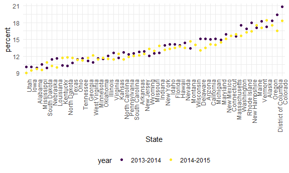
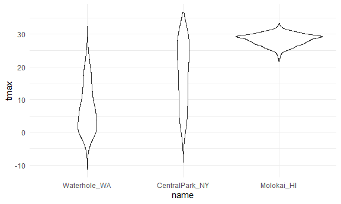
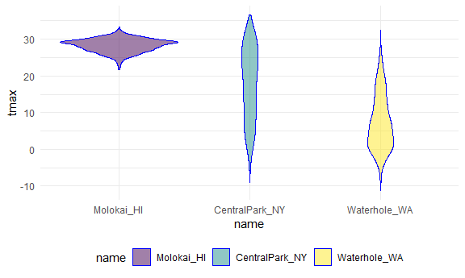

Strings and Factors
================
2026-10-26

## strings and regex

``` r
string_vec = c("my", "name", "is", "meghan")

str_detect(string_vec, "meghan")
```

    ## [1] FALSE FALSE FALSE  TRUE

``` r
str_replace(string_vec, "meghan", "Meghan")
```

    ## [1] "my"     "name"   "is"     "Meghan"

- `str_detect`: detects patterns of character vectors (words, letters,
  number) that is either true or false. CASE SENSITIVE!
- so meghan is true 1 out of the 4 vectors, m is true 3 out of 4, etc.
- `str_replace`: replaces character vector with whatever character
  word/letter/number

``` r
string_vec = c(
  "i think we all rule for participating",
  "i think i have been caught",
  "i think this will be quite fun actually",
  "it will be fun, i think"
  )

str_detect(string_vec, "^i think")
```

    ## [1]  TRUE  TRUE  TRUE FALSE

``` r
str_detect(string_vec, "i think$")
```

    ## [1] FALSE FALSE FALSE  TRUE

- `^` at the beginning of the phrase line, so vectors that start with “i
  think”
- `$` at the end of the phrase line, so vectors that ends with “i think”

``` r
string_vec = c(
  "Time for a Pumpkin Spice Latte!",
  "went to the #pumpkinpatch last weekend",
  "Pumpkin Pie is obviously the best pie",
  "SMASHING PUMPKINS -- LIVE IN CONCERT!!"
  )

str_detect(string_vec,"[Pp]umpkin")
```

    ## [1]  TRUE  TRUE  TRUE FALSE

- `[]` grabs lower- and uppercase…NOT case sensitive!

``` r
string_vec = c(
  '7th inning stretch',
  '1st half soon to begin. Texas won the toss.',
  'she is 5 feet 4 inches tall',
  '3AM - cant sleep :('
  )

str_detect(string_vec, "^[0-9][a-zA-Z]")
```

    ## [1]  TRUE  TRUE FALSE  TRUE

- number first, followed by a letter after (ex. rankings)

``` r
string_vec = c(
  'Its 7:11 in the evening',
  'want to go to 7-11?',
  'my flight is AA711',
  'NetBios: scanning ip 203.167.114.66'
  )

str_detect(string_vec, "7.11")
```

    ## [1]  TRUE  TRUE FALSE  TRUE

``` r
str_detect(string_vec, "7\\.11")
```

    ## [1] FALSE FALSE FALSE  TRUE

- adding a `.` is a special character that captures a character between
  the specified number/letter
- `\\` is a special character and it gets the exact character, no other
  combinations

``` r
string_vec = c(
  'The CI is [2, 5]',
  ':-]',
  ':-[',
  'I found the answer on pages [6-7]'
  )

str_detect(string_vec, "\\[")
```

    ## [1]  TRUE FALSE  TRUE  TRUE

## factors

``` r
factor_vec = factor(c("male", "male", "female", "female"))

as.numeric(factor_vec)
```

    ## [1] 2 2 1 1

- `as.numeric`: converts character vector into values

what happens if i relevel?

``` r
factor_vec = fct_relevel(factor_vec, "male")

as.numeric(factor_vec)
```

    ## [1] 1 1 2 2

- `fct_relevel`: reassigns factor character to a position…before, values
  are automatically are ordered alphabetically

## NSDUH – strings

``` r
url = "https://www.samhsa.gov/data/sites/default/files/NSDUHsaeShortTermCHG2015/NSDUHsaeShortTermCHG2015.htm"

table_mj =
  read_html(url) |> 
  html_table() |> 
  first() |> 
  slice(-1)
```

``` r
data_mj =
  table_mj |> 
  select(-contains("P Value")) |> 
  pivot_longer(
    -State,
    names_to = "age_year",
    values_to = "percent"
  ) |> 
  separate(age_year, into = c("age","year"), sep = "\\(") |> 
  mutate(
    year = str_replace(year, "\\)", ""),
    percent = str_replace(percent, "[a-c]$",""),
    percent = as.numeric(percent)
  ) |> 
  filter(!(State %in% c("Total U.S.", "Northeast", "Midwest", "South", "West")))
```

- `contains` similar to `str_detect`
- the dash (`-`) indicates a removal (no dash means inclusion)
- `sep =`similar to `str_detect`, but for `separate` function
- `!`: don’t want it, filter it out
- `%in%`: selecting which characters to filter

## NSDUH – factors

``` r
data_mj |> 
  filter(age == "12-17") |> 
  mutate(State = fct_reorder(State, percent)) |> 
  ggplot(aes(x = State, y = percent, color = year)) +
  geom_point() +
  theme(axis.text.x = element_text(angle = 90, hjust = 1))
```



- `fct_reorder`: orders one character (State) based on another character
  (percent) and takes the median value of the first character; it ranks
  lowest to highest

## weather data

``` r
data("weather_df")

weather_df |> 
  mutate(name = fct_reorder(name, tmax)) |> 
  ggplot(aes(x = name, y = tmax))+
  geom_violin()
```

    ## Warning: There was 1 warning in `mutate()`.
    ## ℹ In argument: `name = fct_reorder(name, tmax)`.
    ## Caused by warning:
    ## ! `fct_reorder()` removing 17 missing values.
    ## ℹ Use `.na_rm = TRUE` to silence this message.
    ## ℹ Use `.na_rm = FALSE` to preserve NAs.

    ## Warning: Removed 17 rows containing non-finite outside the scale range
    ## (`stat_ydensity()`).



``` r
weather_df |> 
  mutate(name = fct_reorder(name, tmax)) |> 
  lm(tmax ~ name, data = _)
```

    ## Warning: There was 1 warning in `mutate()`.
    ## ℹ In argument: `name = fct_reorder(name, tmax)`.
    ## Caused by warning:
    ## ! `fct_reorder()` removing 17 missing values.
    ## ℹ Use `.na_rm = TRUE` to silence this message.
    ## ℹ Use `.na_rm = FALSE` to preserve NAs.

    ## 
    ## Call:
    ## lm(formula = tmax ~ name, data = mutate(weather_df, name = fct_reorder(name, 
    ##     tmax)))
    ## 
    ## Coefficients:
    ##        (Intercept)  nameCentralPark_NY      nameMolokai_HI  
    ##               7.38               10.28               20.94

- `lm`: regression

``` r
weather_df |>
  mutate(name = forcats::fct_relevel(name, c("Molokai_HI", "CentralPark_NY", "Waterhole_WA"))) |> 
  ggplot(aes(x = name, y = tmax)) + 
  geom_violin(aes(fill = name), color = "blue", alpha = .5) + 
  theme(legend.position = "bottom")
```

    ## Warning: Removed 17 rows containing non-finite outside the scale range
    ## (`stat_ydensity()`).


